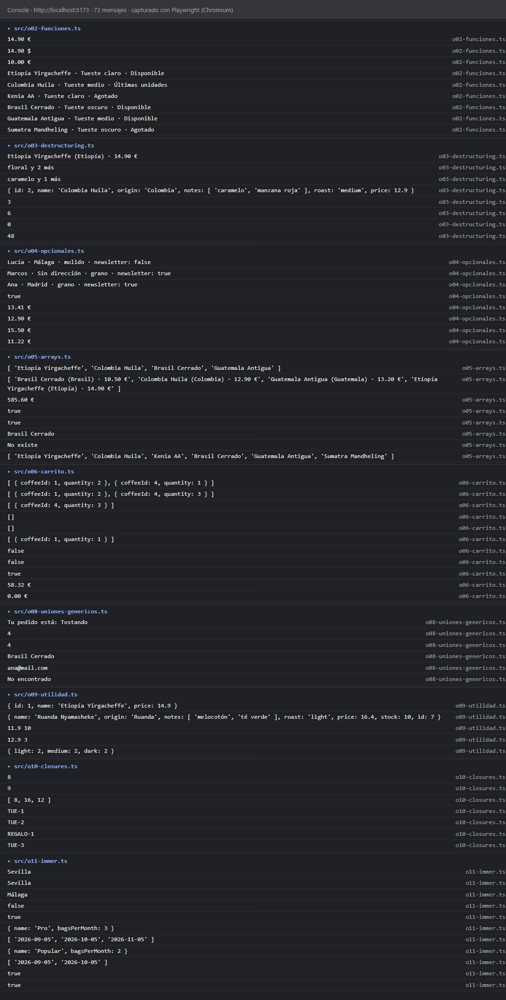

# ☕ Laboratorio · Módulo 02 · JavaScript y TypeScript

Katas sobre el catálogo de cafés de **Tueste** (Lemoncode · Front-end moderno con IA).
Cada kata está en su propio fichero de `src/` e imprime su resultado con `console.log`.

## Cómo arrancarlo

```bash
npm install
npm run dev
```

Abrid la URL que muestra Vite (normalmente <http://localhost:5173>) y la consola de DevTools (**F12 → Console**). Ahí sale la salida de todas las katas.

Para ver la salida en la terminal, sin navegador:

```bash
npx tsx src/main.ts            # todas las katas
npx tsx src/o06-carrito.ts     # una kata suelta
```

`src/main.ts` solo importa cada kata (`import "./o02-funciones";`…) para que se ejecuten todas.

## Captura de la consola

Salida de todas las katas al abrir la página con `npm run dev`: 73 mensajes, sin errores ni avisos.



> La captura está hecha con **Playwright** (Chromium). Playwright no puede fotografiar el panel de DevTools, así que se interceptó `console.log` en la propia página, se ejecutaron las katas y sus mensajes se mostraron en la página con el estilo de la consola. El contenido es el mismo que sale en **F12 → Console**. La O7 no imprime nada, porque solo clasifica funciones.

## Comprobación de tipos

Vite quita los tipos sin comprobarlos, así que la comprobación se hace aparte:

```bash
npx tsc
```

✅ **`npx tsc` sale sin errores** (sin ninguna salida).

## Estructura

| Fichero | Kata |
|---|---|
| `src/types.ts` | O1 · `Roast`, `Grind`, `Coffee`, `Address`, `Preferences`, `Customer` |
| `src/data.ts` | Datos del enunciado, copiados tal cual |
| `src/o01-tipos.ts` | O1 · Los tres errores provocados |
| `src/o02-funciones.ts` | O2 · `formatPrice`, `stockStatus`, `roastLabel` |
| `src/o03-destructuring.ts` | O3 · `coffeeCard`, `mainNote`, `toPublicCoffee`, `sumAll` |
| `src/o04-opcionales.ts` | O4 · `getCity`, `getGrind`, `wantsNewsletter`, `finalPrice` |
| `src/o05-arrays.ts` | O5 · `availableCoffees`, `catalogLabels`, `stockValue` |
| `src/o06-carrito.ts` | O6 · `addToCart`, `removeFromCart`, `changeQuantity`, `cartTotal` |
| `src/o07-pureza.ts` | O7 · Seis funciones clasificadas y sus versiones puras |
| `src/o08-uniones-genericos.ts` | O8 · `OrderStatus`, `statusLabel`, `normalizeId`, `findById` |
| `src/o09-utilidad.ts` | O9 · `CoffeePreview`, `NewCoffee`, `updateCoffee`, `countByRoast` |
| `src/o10-closures.ts` | O10 · `createDiscount`, `createOrderIdGenerator` |
| `src/o11-immer.ts` | O11 · `movedSpread`, `movedImmer`, `upgraded` |


## Respuestas a las preguntas 📝 y 🔍

### O1 · Tipar el catálogo (🔍 en `src/o01-tipos.ts`)

| Error provocado | Mensaje de TypeScript | Por qué |
|---|---|---|
| `roast: "extra"` | `Type '"extra"' is not assignable to type 'Roast'.` | `Roast` es una unión cerrada de tres literales y `"extra"` no está entre ellos. |
| Café sin `price` | `Property 'price' is missing in type '{ ... }' but required in type 'Coffee'.` | `price` no lleva `?` en la interfaz, así que es obligatoria. |
| `coffees[0].id = 2` | `Cannot assign to 'id' because it is a read-only property.` | `id` es `readonly`. Es solo una comprobación de compilación: en JavaScript el `id` sí cambiaría. |

### O2 · Funciones básicas (🔍 en `src/o02-funciones.ts`)

Al quitar un `case` del `switch` de `roastLabel`, TypeScript da `Function lacks ending return statement and return type does not include 'undefined'`. Con ese tueste la función no llegaría a ningún `return` y devolvería `undefined`, que no encaja con el tipo de retorno `string`. Al ejecutarlo sin el `case`, Brasil y Sumatra salían como `undefined`.

### O3 · Destructuring y rest (`src/o03-destructuring.ts`)

- **📝** El `...` de `sumAll(...coffees.map(...))` es **spread**, no rest. Aparece donde se **invoca** la función, no donde se declaran los parámetros. Expande el array `[12, 3, 0, 25, 8, 0]` en argumentos sueltos, y dentro de `sumAll` el rest los vuelve a agrupar en `amounts`.
- **🔍** El `stock` que se extrae en `toPublicCoffee` y no se usa **no** da error de "declared but never read". Hace falta para sacarlo del `...publicCoffee`, y TypeScript no marca como sin usar las propiedades que van al lado de un rest.

### O4 · Opcionales (🪤 en `src/o04-opcionales.ts`)

`wantsNewsletter2`, con `||`, devuelve `true` para Lucía aunque ella tiene `newsletter: false`. `false` es *falsy* y `||` elige la derecha con **cualquier** valor *falsy*. `??` solo la elige con `null` o `undefined`, así que respeta el `false` de Lucía.

### O5 · Métodos de arrays (🔍 en `src/o05-arrays.ts`)

Al cambiar `toSorted` por `sort` en `catalogLabels`, el catálogo original **no** se desordena, porque `filter` va antes y crea un array nuevo: `sort` muta esa copia local. Si `sort` se pone **antes** que `filter`, muta directamente el array que recibe la función y `coffees` queda ordenado por precio. Por eso se usa `toSorted` siempre: no depende del orden de la cadena.

### O7 · ¿Pura o impura? (`src/o07-pureza.ts`)

| # | Función | ¿Pura? | Por qué | Versión pura |
|---|---|---|---|---|
| 1 | `totalWithShipping` | ❌ | Lee `shippingCost`, una variable externa con `let`: misma entrada, distinta salida | Recibir el coste como parámetro |
| 2 | `applyDiscount` | ❌ | Muta el café que recibe | `{ ...coffee, price: … }` |
| 3 | `namesInCapitals` | ✅ | `map` crea un array nuevo y el callback solo lee `name` | — |
| 4 | `sortByPrice` | ❌ | `sort` muta la lista que recibe | `toSorted` |
| 5 | `createOrderId` | ❌ | `Date.now()` cambia en cada llamada | Recibir el `timestamp` como parámetro |
| 6 | `buildTags` | ✅ | El `push` es sobre `tags`, un array **local**: mutar dentro es aceptable | — |

### O8 · Uniones, Record y genéricos (🔍 en `src/o08-uniones-genericos.ts`)

- Al borrar `delivered` de `statusLabel`: `Property 'delivered' is missing in type '{ pending: string; roasting: string; shipped: string; }' but required in type 'Record<OrderStatus, string>'.` Con una unión de literales como clave, `Record` obliga a cubrir todos los casos.
- `findById(coffees, 4)` devuelve `Coffee | null` y `findById(customers, 3)` devuelve `Customer | null`. El genérico conserva el tipo concreto de cada lista.

### O10 · Closures (📝 en `src/o10-closures.ts`)

- `.map(blackFriday)` va **sin paréntesis** porque se pasa la función para que `map` la llame con cada precio. `blackFriday()` la ejecutaría en ese momento y pasaría un número.
- `blackFriday` **es pura**: el `rate` que recuerda el closure no cambia nunca.
- `nextOrderId` **no es pura**: cada llamada devuelve un id distinto y modifica su contador interno.

### O11 · Immer (📝 en `src/o11-immer.ts`)

Immer es más legible para cambios dentro de un árbol: una línea sobre el borrador, frente a un spread por nivel en el que olvidar uno significa mutar sin querer. Spread para cambios superficiales (como el carrito de la O6), Immer cuando el estado está anidado o hay varios cambios a la vez.

## Checklist

**Obligatorios**

- [x] O1 · Tipar el catálogo
- [x] O2 · Funciones básicas
- [x] O3 · Destructuring y rest
- [x] O4 · Opcionales
- [x] O5 · Métodos de arrays
- [x] O6 · Carrito inmutable ⭐
- [x] O7 · ¿Pura o impura?
- [x] O8 · Uniones, Record y genéricos
- [x] O9 · Tipos de utilidad
- [x] O10 · Closures
- [x] O11 · Immer
- [x] O12 · README + bitácora de IA

**Opcionales**

- [ ] P1 · Tests con Vitest
- [ ] P2 · Deshacer en el carrito
- [ ] P3 · Agrupar con reduce
- [ ] P4 · sortBy genérico
- [ ] P5 · `unknown`
- [ ] P6 · myMap y myFilter
- [ ] P7 · Tipos del TFM

**Desafíos**

- [ ] D1 · Catálogo en la landing
- [ ] D2 · Uniones discriminadas
- [ ] D3 · Coste de la inmutabilidad
- [ ] D4 · Reducer con Immer
- [ ] D5 · myReduce

## 🤖 Bitácora de IA

**Herramienta:** Claude Code (Claude Opus 5.5) con una skill de "profesor asistente" que me guía kata a kata con pistas y esqueletos. Cuando me atascaba le pedía la solución, y en esos casos me la explicaba línea a línea.

### O1 · Tipar el catálogo: usar un tipo como si fuera un valor

#### Prompt

"Estoy con el error 2 pero algo está mal" (en `o01-tipos.ts`, el café sin `price` daba otro error además del que buscaba).

#### Qué me dio

No me dio el código corregido. Me señaló el error `TS2693: 'Roast' only refers to a type, but is being used as a value here` de la línea `roast: Roast` y me preguntó si `Roast` es un valor o un tipo, recordándome que los tipos desaparecen al compilar (tema 10).

#### Qué corregí y por qué

Cambié `roast: Roast` por `roast: "light"`. `Roast` es un alias de tipo: solo existe para TypeScript y se borra al compilar, así que no puede ser el valor de una propiedad. En su lugar va uno de los literales de la unión. Así el café solo falla por la falta de `price`, que era lo que tenía que demostrar el experimento. También quité `Roast` del `import type`, porque ya no se usaba y `noUnusedLocals` lo marcaba como error.

### O9 · `createCoffee`: el ejemplo de la IA dejaba el `id` expuesto

#### Prompt

Le pedí que me explicara cómo hacer `createCoffee` con `Omit` y el id máximo + 1.

#### Qué me dio

Un ejemplo con este patrón: `({ id: Math.max(...list.map((t) => t.id)) + 1, ...data })`.

#### Qué corregí y por qué

Hice dos cambios:
- **Puse `id` después de `...data`.** En un objeto gana la última propiedad escrita (tema 21). `NewCoffee` no tiene `id`, pero por el tipado estructural se le puede pasar una variable que sí lo tenga. Con el spread al final, ese `id` pisaría el calculado.
- **Añadí un mínimo: `Math.max(0, ...ids)`.** Con una lista vacía, `Math.max()` devuelve `-Infinity`, y el nuevo id sería `-Infinity`. Con el `0`, el primer café recibe el id `1`.

Los dos fallos los señaló la propia IA cuando le pregunté por el orden del spread y por la lista vacía. El ejemplo inicial funcionaba con los datos de la kata, pero no en esos casos.

### O9 · `countByRoast`: la alternativa "más óptima" necesitaba un `as`

#### Prompt

"No acabo de comprender por qué hay que hardcodear las claves de `Roast` como valores iniciales. ¿No existe una forma más óptima?"

#### Qué me dio

Una alternativa: declarar `const ROASTS = ["light", "medium", "dark"] as const`, derivar de ahí el tipo `Roast` y generar el valor inicial con `Object.fromEntries(ROASTS.map((r) => [r, 0]))`. Lo probó y me enseñó que TypeScript lo rechaza: `Type '{ [k: string]: number; }' is missing the following properties from type 'Record<...>'`.

#### Qué corregí y por qué

No la usé. Para que compilara habría que forzarla con `as Record<Roast, number>`, y el curso pide evitar los `as`, porque silencian al compilador en vez de dejar que compruebe. Además obligaba a cambiar cómo está definido `Roast` en `types.ts`. Me quedé con `{ light: 0, medium: 0, dark: 0 }`. Las claves están escritas a mano, pero el `Record<Roast, number>` del tipo de retorno avisa si falta alguna. Lo que aprendí: los tipos no existen en ejecución, así que no se puede recorrer una unión para generar valores.

### O5 · El 🔍 de `sort` no se veía

#### Prompt

"He cambiado a `sort` pero no aprecio ningún cambio."

#### Qué me dio

Me explicó por qué: en `catalogLabels` el `filter` va antes, crea un array nuevo y `sort` muta esa copia local, no `coffees`. Me propuso poner `sort` delante del `filter` para ver la mutación de verdad.

#### Qué corregí y por qué

Mantuve `toSorted`. Aunque en este orden `sort` no estropeaba nada, depende de que nadie reordene la cadena. Si alguien pusiera el `sort` primero, mutaría el catálogo de todo el programa. `toSorted` es seguro en cualquier posición. Lo que aprendí: lo que rompe la inmutabilidad no es mutar, sino mutar algo que llegó de fuera.


